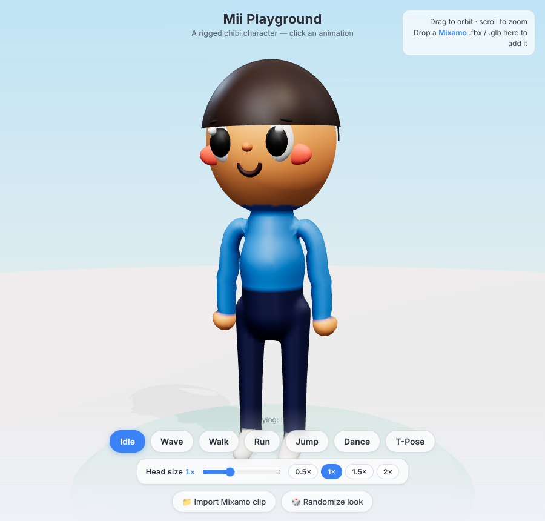

# Mii Playground

A small Three.js scene with a **procedurally-built, smooth-shaded chibi
character** that is rigged to a Mixamo-compatible humanoid skeleton. Click a
button to switch between hand-authored animations, **slide the head-to-body
ratio** (0.5×–2×), randomize the character's look, or drop in a real Mixamo
animation file.



## Run it

It's plain HTML + ES modules with Three.js vendored locally (no build step,
no internet needed). Serve the folder with any static server:

```bash
python3 -m http.server 8000
# then open http://localhost:8000
```

(Opening `index.html` directly won't work — ES modules need to be served over
`http://`.)

## What's inside

```
index.html          UI, styles, import map
src/mii.js          builds the Mii SkinnedMesh + skeleton (Mixamo bone names)
src/animations.js   hand-authored AnimationClips (Idle, Wave, Walk, Run, …)
src/mixamo.js       loads & retargets a dropped Mixamo .fbx/.glb onto the rig
src/main.js         scene, lights, render loop, animation switching, UI
vendor/             Three.js r160 + addons (OrbitControls, loaders, SkeletonUtils)
```

## How the rigging works

The body is **one cohesive, smoothly-skinned mesh**, not a pile of overlapping
primitives:

* **Implicit surface.** The body is defined as a signed-distance *field* — a
  blend of tapered capsules (round cones) plus an ellipsoid head. Each limb's
  own cones are joined with a plain union (so elbows/knees stay slim tubes, no
  bulge), and only the torso joints and limb-to-body junctions get a small
  smooth fillet — seamless but not puffy.
* **Marching cubes.** That field is polygonized into a single watertight mesh
  (`src/mii.js` runs a compact marching-cubes pass, reusing the standard
  `edgeTable`/`triTable` from three's `MarchingCubes` addon). Vertex normals
  come from the field gradient, so the surface is smooth at any resolution.
* **Automatic smooth skinning.** Each generated vertex is weighted to its 2–3
  nearest bones with a falloff, so elbows and knees deform as one continuous
  skin instead of creasing. Vertex colors come from the nearest body region
  (with a crisp waistline), drawn by a single `MeshStandardMaterial`.
* **Face + hair** are separate overlay pieces merged into the same mesh — they
  sit flush on the surface, which is standard practice.
* Everything is lit by an image-based `RoomEnvironment` for a soft, rounded
  look. Changing the head size re-runs the field + marching-cubes pass.
* The skeleton uses **Mixamo's bone names** (`mixamorigHips`,
  `mixamorigLeftArm`, …) in a standard T-pose. That's what lets Mixamo clips
  retarget cleanly onto it.

## Using your own Mixamo animations

1. Grab an animation from [mixamo.com](https://www.mixamo.com) — **Download**
   as **FBX** (or glTF/GLB). "Without Skin" is fine since we only need the clip.
2. Drag the file onto the page (or click **Import Mixamo clip**).
3. A new button appears for it; the motion is retargeted onto the Mii.

The retargeter (`three/addons/utils/SkeletonUtils` → `retargetClip`) transfers
the source skeleton's rotations onto the Mii while keeping the Mii's own bone
lengths. Root translation is stripped so clips play in place.

### Adding more built-in animations

Edit `src/animations.js`. Each clip is just per-bone Euler keyframes (degrees):

```js
clips['MyMove'] = clip('MyMove', 1.5, {
  RArm: { t: [0, 0.75, 1.5], k: [[0,0,78],[0,0,-60],[0,0,78]] },
  // bone aliases: Hips, Spine, Head, LArm, LFore, LUpLeg, LLeg, ... (see mii.js BONE)
  // `hips` is special: { t, k:[[dx,dy,dz],...] } drives Hips position (bob/jump)
});
```

Then add the name to the `BUILTIN` array in `src/main.js`.
